  

Tenho interesse em tecnologia e em como ela pode transformar ideias em soluções práticas.
Busco constantemente aprimorar meus conhecimentos e desenvolver novas habilidades.

Busco criar interfaces funcionais, organizadas e intuitivas.
Também tenho interesse na estruturação, organização e gerenciamento de dados.
Procuro compreender os desafios de cada projeto para encontrar soluções adequadas.
Estou sempre disposto a aprender novas ferramentas e aprimorar minhas habilidades técnicas.

Atualmente, busco uma oportunidade de estágio ou uma posição júnior na área de tecnologia.
Quero colocar meus conhecimentos em prática e adquirir experiência no ambiente profissional.
Meu objetivo é construir uma carreira sólida e evoluir continuamente na área.
